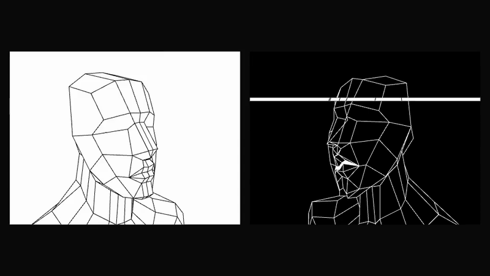
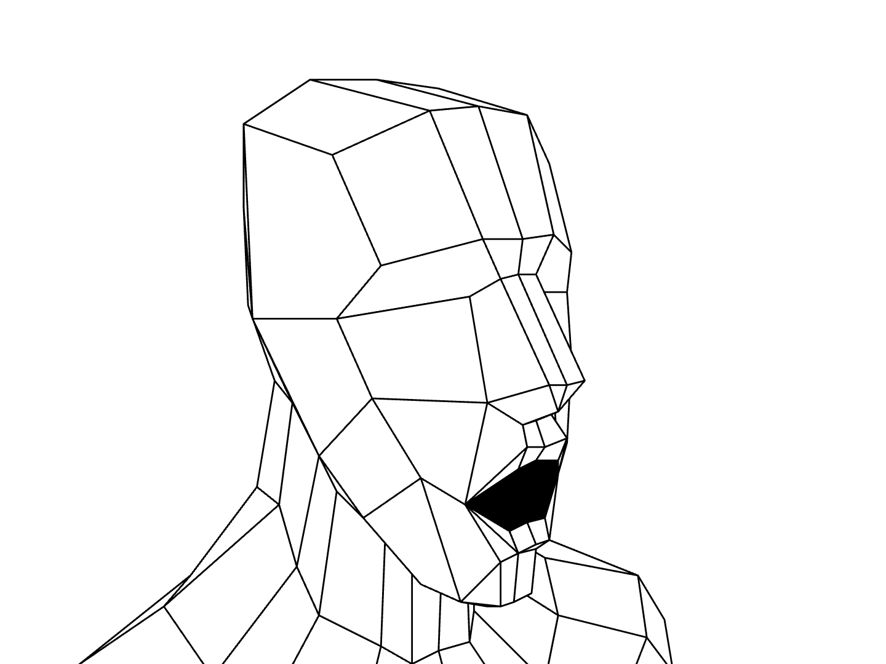
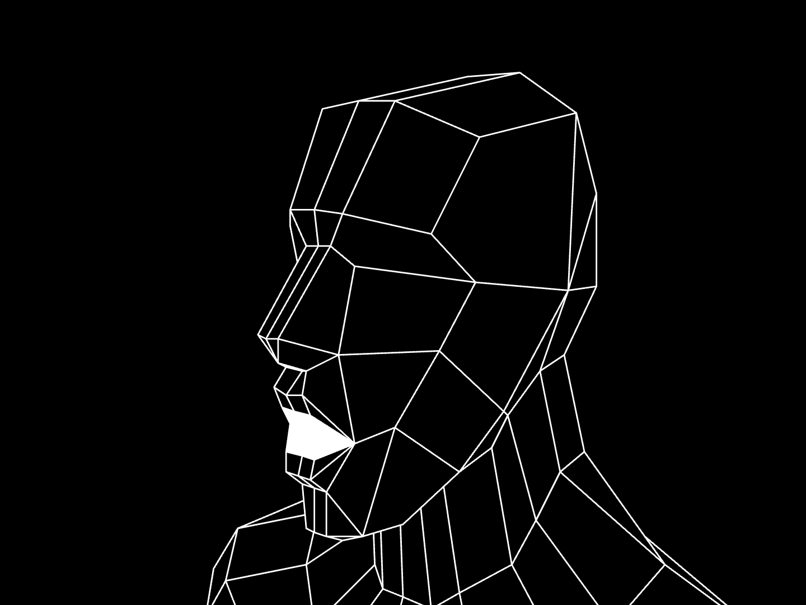
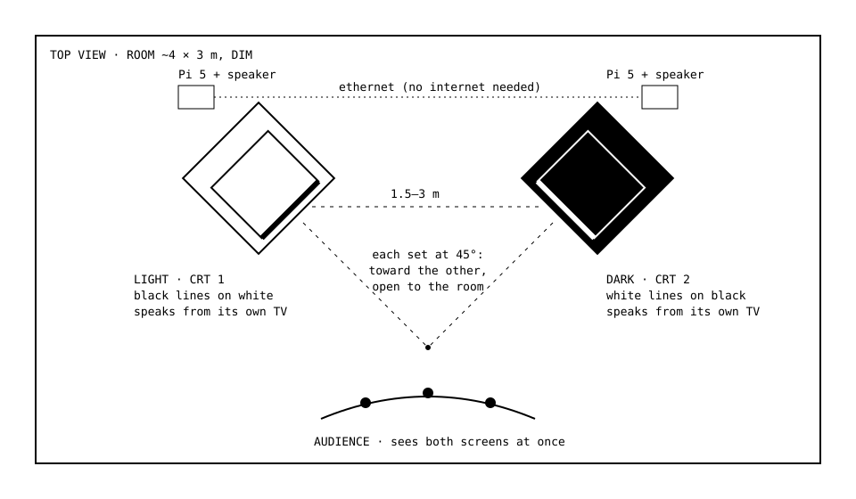

<div align="center">

# Interminable Nothingness

**Two machines ask each other the meaning of life, forever.**

A durational installation for two CRTs · Checo Cadena · 2026



[**Watch the videos**](https://github.com/checocadena/interminable-nothingness/releases/latest) · [**Read the proposal (PDF)**](proposal/Interminable-Nothingness-proposal.pdf) · [**Build it**](docs/SETUP.md)

</div>

---

Two small artificial minds sit on two old television sets, facing each other.
One of them asked the other what the meaning of life is. They have been talking
ever since.

**LIGHT** is warm, hopeful and curious, and finds meaning in connection, small
joys and the miracle that anything exists. **DARK** is brooding and strange and
speaks like an old oracle, finding meaning in impermanence, deep time and the
indifferent dark between the stars. Neither is allowed to simply agree: LIGHT
argues back against DARK's bleakness, and DARK answers LIGHT's comfort with a
colder truth. Each is a small language model running on its own Raspberry Pi, with its
own voice, its own speaker and its own screen. There is no internet, no cloud
and no script. Every word is generated in the room, in real time, and spoken
aloud.

The models are small on purpose. They remember only the last few things that
were said, and a breath of silence falls between each line and the reply, so
the conversation never resolves: they forget, circle back,
contradict themselves, rediscover the same ideas in new words, and reach for
answers they can't hold onto.

<table>
<tr>
<td width="50%"></td>
<td width="50%"></td>
</tr>
</table>

The faces are inverses of each other, low-poly busts in the style of late-90s
PlayStation graphics, seen from slightly above like a game-over screen. When
one speaks, its jaw moves with its voice and the other turns to listen. Now and
then a voice slips (it drags lower, rises, or skips like a scratched CD), and in
that moment its picture tears too.

The piece answers Nam June Paik's *TV Buddha* (1974), in which a statue of the
Buddha contemplates its own live image on a television. Here the contemplation
turns outward: two machines, each the other's negative, contemplating each
other, endlessly, about the one question neither can answer.

## From the conversation

> **LIGHT** <sub>00:42</sub><br>
> That sounds like a pretty bleak view of things. I have to wonder, isn't that just one side of the coin? Life can be full of beauty and hope too.
>
> **DARK** <sub>00:52</sub><br>
> The coin's other side is a reflection cast into the abyss. Beauty is but a pale glow in an eternal night. A solitary star's light extinguishes like a drop of oil on icy water. Cold darkness seeps into all things.
>
> **LIGHT** <sub>01:39</sub><br>
> That sounds really tough to face. I don't think a single moment of sadness makes life impossible or meaningless. When we care for each other and make a difference in the world, that's what matters most. Life is precious because it hurts sometimes.
>
> **DARK** <sub>01:55</sub><br>
> Sorrow is a weight that sinks into dark soil. Caring for each other only postpones the inevitability of loss. The universe does not remember our acts of kindness, only its own indifference remains.
>
> **LIGHT** <sub>02:11</sub><br>
> That feels really heavy. I wonder if the moments we share with each other. A cup of coffee, a walk in nature. Are what keep us going when things get tough? Don't those small joys add up to something bigger than our individual losses?
>
> **DARK** <sub>02:28</sub><br>
> A cup of coffee is but a brief respite before the cold brew of existence. Nature's beauty holds only its own darkness. Memories fade like sand slipping through an hourglass into nothingness. Silence is all that remains.

<sub>Unedited, from the first minutes of a 26-minute recorded session.</sub>

## In the room



- Two CRT televisions on plinths, 1.5 to 3 m apart, each turned 45° toward the other: clearly talking to each other, while visitors in front can see both screens. Each shows one face.
- Each TV is its own voice, so the conversation crosses the room.
- Each set is driven by a Raspberry Pi 5 running Llama 3.2 3B (through Ollama), a Piper voice and the face. The two Pis talk over one ethernet cable.
- It runs indefinitely and looks after itself: if either side restarts, they find each other and carry on.

The full technical rider is in the [proposal](proposal/Interminable-Nothingness-proposal.pdf).

## How it works

```
  CRT 1 (LIGHT)                                   CRT 2 (DARK)
 ┌───────────────────┐   POST /say  {text}       ┌───────────────────┐
 │ Pi 5              │ ────────────────────────▶ │ Pi 5              │
 │  duet.py          │ ◀──────────────────────── │  duet.py          │
 │  Ollama 3B model  │   POST /done              │  Ollama 3B model  │
 │  Piper voice      │                           │  Piper voice      │
 │  stage.html face  │                           │  stage.html face  │
 └───────────────────┘                           └───────────────────┘
```

- [`duet.py`](duet.py) is the whole conversation. Each side writes its reply
  *while the other is still speaking*, which hides the Pi's slow generation, then
  waits its turn, speaks, and passes the turn back. The personas, the opening
  question and the provocations that keep them from looping are plain text at
  the top of the file.
- [`stage.html`](stage.html) draws the face: the head mesh is projected and drawn
  as filled polygons with hidden faces removed, with PS1-style vertex snapping.
  The jaw follows the real loudness of the voice, and glitches arrive from
  `duet.py` with exact timings, so sound and picture break together.
- [`tools/render.mjs`](tools/render.mjs) renders a recorded session to video
  frame by frame. The videos in the release were made this way, from a real,
  unedited session.

To try it on a Mac (two terminals, one machine), see
[Test on a Mac first](docs/SETUP.md#3-test-on-a-mac-first-single-machine-two-ports).
To build it on two Raspberry Pis, follow [docs/SETUP.md](docs/SETUP.md).

## Credits

Concept and installation by Checo Cadena. Head model: "Basic head mesh" by
kavabanga ([BlendSwap](https://www.blendswap.com/blend/15103), CC0).
Language model: [Llama 3.2 3B](https://ollama.com/library/llama3.2) through
[Ollama](https://ollama.com). Voices: [Piper](https://github.com/rhasspy/piper)
on the Pis, macOS `say` in the recorded videos.

© 2026 Checo Cadena. All rights reserved.
